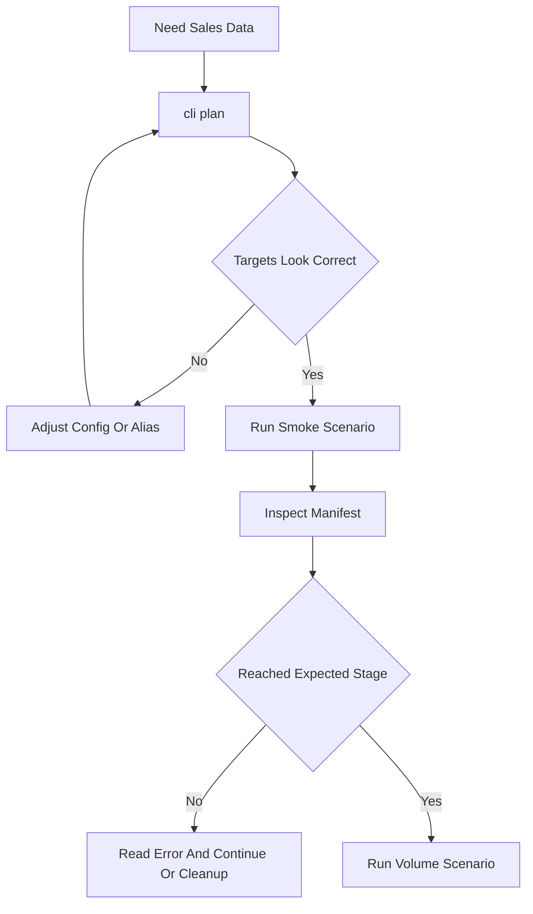

# AI Tools Guide — Transaction Data Harness

This file is the model-facing operating guide for creating and working with
Revenue Cloud transaction demo data. Prefer these commands over ad hoc API calls
unless you are changing the harness itself.

## Golden Rules

1. Always plan first with `--dry-run` / `cli plan`; do not write records until the
   account, product, stage caps, and target org look correct.
2. `--org` is an **sf CLI alias or username**, not a CCI-only alias.
3. Treat every run as additive. Re-running creates new records with a new run id.
4. Use manifest ids for verification and cleanup. Do not rely on
   `Order.Description` SOQL filters; that field is not filterable.
5. Do not claim a Posted invoice exists until the manifest has `reached_stage:
   "post"` and an org query confirms the invoice id/number or order link.
6. Posted invoices and BillingSchedules are platform-managed leftovers. Plan demo
   orgs accordingly; cleanup cannot fully restore a pre-run state.

## Tool Surface

### Plan Only

```bash
python -m scripts.txn_data_harness.cli plan --org <sf-alias> \
  --config scripts/txn_data_harness/scenarios/sales_txn_quote/01-smoke-test.yaml
```

Use this before every write. It resolves auth, org discovery, account/product
targets, start-date ranges, stage caps, and concurrency without creating records.

### Run

```bash
python -m scripts.txn_data_harness.cli run --org <sf-alias> \
  --config scripts/txn_data_harness/scenarios/sales_txn_quote/01-smoke-test.yaml \
  --concurrency 1 -v
```

Start with a smoke test before volume. Increase `--concurrency` gradually; higher
values are not broadly tested against API limits and async billing contention.

`--count N` does NOT shrink a `--config` whose scenarios pin `count:` (per-scenario
wins over CLI; see `scenarios/README.md` → Precedence). To smoke a multi-scenario
config, edit the per-scenario `count:` to 1 (or copy the scenario you want into a
small one-off config) rather than relying on `--count`.

Transient failures (network blips, `UNABLE_TO_LOCK_ROW`, rate limits) are retried
automatically, resuming from the last checkpointed stage. Tune with
`--max-retries N` (default 2; `0` disables). Deterministic failures (e.g. a
missing field, a precondition like "quote_id is required before order") fail fast
and are never retried. After a batch, a report is written to
`out/<base_run_id>-report.json` (and `.md`) with success/failure counts, a
stage-reached histogram, and a failure-signature rollup.

Activation only checkpoints `reached_stage: "activate"` after BillingSchedule
polling and asset polling complete. Draft invoice ingestion retries only when a
transient failure happens before any invoice id is observed; once an invoice id
is known, the manifest records it and stops rather than replaying the ingest
graph.

### Inspect

```bash
python -m scripts.txn_data_harness.cli inspect --latest
python -m scripts.txn_data_harness.cli inspect --manifest scripts/txn_data_harness/out/<run_id>.json
python -m scripts.txn_data_harness.cli inspect --latest --json    # machine-readable
```

Use inspect after every run. The default output is human-readable. Pass `--json`
for scripted workflows; JSON includes `run_id`, account, reached stage, error,
line count, created ids, invoice number, warning fields, and a `path` field that
can be piped into `cli step --manifest`.

### Rate (usage orchestration — one-shot, ~15 min, org-wide)

```bash
python -m scripts.txn_data_harness.cli rate --org <sf-alias>
python -m scripts.txn_data_harness.cli rate --org <sf-alias> --flow-name <flow>
```

Invokes `RLM_UsageOrchestrationController.startOrchestration(...)` via
anonymous Apex to start `RLM_OrchestrateUsageManagement` (or another flow
via `--flow-name`). The job runs asynchronously, processes **every** usage
product in the org, and typically takes ~15 minutes. Fires and exits — no
polling. Run **once per batch** after `usage`-stage scenarios finish, then
monitor in Setup → Monitor Workflow Services and verify rated output by
SOQL (`TransactionJournal.Status` flips `Pending → Processed`, `UsageSummary`
rows appear).

### Continue To A Stage

```bash
python -m scripts.txn_data_harness.cli step --org <sf-alias> \
  --manifest scripts/txn_data_harness/out/<run_id>.json \
  --account "<billing-ready-account-name>" \
  --to-stage invoice_draft
```

The step command runs the remaining lifecycle steps from the manifest's
`reached_stage` through `--to-stage`. It uses the shared step registry, so it
preserves the live-verified ordering rules.

### Report

```bash
python -m scripts.txn_data_harness.cli report <base_run_id>
python -m scripts.txn_data_harness.cli report <base_run_id> --markdown
```

Rebuilds the batch report from manifests already on disk (all `out/*.json` sharing
the `<base_run_id>` prefix). Use it to re-summarize an older batch or to read a
failure-signature rollup when triaging which scenarios to continue or clean up.

### Verify billing (read-only)

```bash
python -m scripts.txn_data_harness.cli verify --org <sf-alias> --latest --json
python -m scripts.txn_data_harness.cli verify --org <sf-alias> --manifest <run_id>
python -m scripts.txn_data_harness.cli verify --org <sf-alias> \
  --invoice-ids <invoiceId>,<invoiceId> --payment-ids <paymentId>
```

Checks, by id and with SOQL only, that each invoice, invoice line and payment
balance agrees with its payment and credit applications, and that the
applications are at one level (line or header). Exit 0 when nothing fails,
skips included, so read the counts (`RESULT: pass (N checked, M skipped)`, or
`no balances checked`; `checked` and `skipped` in `--json`, counting one result
per invoice, per checked line or skipped invoice (an invoice whose lines
cannot be read is one failed result, counted as checked), and per payment); 1 on any
failed check, 2 with an `ERROR:` line for bad input (unknown or malformed
id, missing or malformed manifest, refused query, failed connection, no `sf`
on `PATH`, any unexpected error); with `--json` an error also prints
`{"ok": false, "error": ...}`. A usage error (no `--org`, bad
`--expect-level`, an unrecognized or extra argument) exits 2 with argparse
usage on stderr and, when the command line contains `--json`, one
`{"ok": false, "error": "usage: ..."}` object on stdout. Abbreviated options
are refused. Ids may be 15 or 18
characters. Harness manifests carry no payment ids: payments are found
through the invoices' application rows, or passed with `--payment-ids`.
`--latest` checks only the newest manifest: after a batch of several
scenarios, pass each manifest (`--manifest` repeats) or the ids. Balance checks run only on records
inside one allow-list of measured cases (Line Level: Posted invoices, taxed
ones included, without write-off or other unmeasured totals, separate Tax lines
or header-captured tax; Charge lines; Applied rows; Processed
payments with applications or Canceled ones without; Posted credit memos), and
an invoice and a payment or credit memo joined by a row are measured only
together; anything else skips naming its first cause and origin.
`--expect-level line|header` forces the level (default: detect from the
records). Checks and formulas: `billing-operations` → `verification.md`.

### Prune

```bash
python -m scripts.txn_data_harness.cli prune --older-than 7d        # dry run
python -m scripts.txn_data_harness.cli prune --older-than 7d --yes  # delete
```

Deletes manifest JSON in `out/` older than the retention window (`7d` / `24h` /
`30m`). Defaults to a dry run; pass `--yes` to delete. Only the harness's own
`out/` directory can be pruned.

### Recipes — direct-Order PST (`kind: sales_txn_order`)

When the demo needs an Order without a Quote upstream (channel-style flow,
exported-order ingestion, "place the order directly"), use the
`sales_txn_order` kind. The post-Order tail is identical to the quote path —
Activate, BillingSchedule + Asset, Draft invoice, Posted invoice — so the only
behavioral difference is the head:

```yaml
defaults:
  kind: sales_txn_order
  target_stage: invoice_posted

scenarios:
  - account: "<billing-ready-account-name>"
    products:
      - sku: "<term-defined-sku>"
        quantity: 1
    count: 5
```

Reference config: `scenarios/sales_txn_order/16-direct-orders.yaml`.

Rules:

- **The `AppUsageAssignment` row is mandatory.** `createOrderFromQuote` writes
  it implicitly on the quote path; PST direct-place does not. The harness
  POSTs `AppUsageAssignment(AppUsageType = RevenueLifecycleManagement,
  RecordId = <orderId>)` between Order place and `Order.Status = Activated`.
  Without that row, the platform can flip the status without emitting a
  BillingSchedule, Asset, or AsyncOperationTracker. The supported direct-Order
  path always writes the row before activation; do not skip it in any
  extension.
- **`quote_placed` is not a valid `target_stage`** for this kind. The order
  path skips the Quote entirely; pin `order_draft` (or further) instead.
- **Field-level divergences from QuoteLineItem.** `OrderItem.ServiceDate`
  (not `StartDate`), `SubscriptionTerm` only (no `SubscriptionTermUnit`),
  and `Discount` round-trips on the OrderItem (unlike QuoteLineItem, where
  the engine reads it back as 0). The live-verified field contract is in
  `docs/contracts-sales-txn-order.md`.

### Recipes — subscription terms

```yaml
# Place a 3-year subscription on a TermDefined product.
scenarios:
  - account: "<billing-ready-account-name>"
    products:
      - sku: "<term-defined-sku>"
        term: {count: 3, unit: Annual}
```

```yaml
# Place a 4-quarter (1-year on a Quarterly SOM) subscription. The SKU MUST
# be bound to a PBE whose ProductSellingModel.PricingTermUnit = "Quarterly".
scenarios:
  - account: "<billing-ready-account-name>"
    products:
      - sku: "<quarterly-term-sku>"
        term: {count: 4, unit: Quarterly}
```

```yaml
# Bare-int form -- count only; unit follows the resolved PSM.
scenarios:
  - account: "<billing-ready-account-name>"
    products:
      - sku: "<term-defined-sku>"
        term: 24
```

Rules to keep in mind when authoring `term:`:

- `unit` is the `ProductSellingModel.PricingTermUnit` picklist: `Months`,
  `Quarterly`, `Semi-Annual`, `Annual`. `Years` is accepted as an alias for
  `Annual`. Anything else (e.g. `Days`) raises `ConfigError`.
- An explicit `unit` must equal the resolved PSM's `PricingTermUnit`; the
  harness will not implicitly switch PBEs. Pin `selling_model: "<PSM Name>"`
  on the product entry when a SKU has multiple PBEs.
- `term` is for **TermDefined** products only. The platform rejects `EndDate`
  (and the SubscriptionTerm fields) on Evergreen / OneTime lines, so the
  config layer raises before the call goes out.
- The harness writes `SubscriptionTerm` and `SubscriptionTermUnit` **only**;
  it never writes `EndDate`, `PricingTerm`, or `PricingTermCount`. The
  platform derives `EndDate` (inclusive `start + term - 1 day`) and
  recalculates the pricing-term fields from your inputs + the PBE. Verify a
  term by reading all of those back.

Full schema in `scenarios/README.md` → *Subscription terms*.

### Recipes — explicit `end_date` (co-term / off-cycle)

When the demo needs a **specific** `EndDate` (co-terming a multi-line
quote to one calendar anchor; landing on a fiscal-quarter boundary; an
off-cycle ramp), pin `end_date:` alongside `term:`. The platform honors
the explicit date and prorates `PricingTermCount` against the actual span
(~0.27% drift for a 366-day "1×Annual" line).

```yaml
# Scenario-level co-term: every TermDefined line on the quote anchors to
# 2027-01-14 regardless of individual cadences.
scenarios:
  - account: "<billing-ready-account-name>"
    term: {count: 1, unit: Annual}
    end_date: "2027-01-14"
    products:
      - sku: "<term-defined-sku>"
      - sku: "<another-term-defined-sku>"
```

```yaml
# Per-line relative offset. Supported units: d, mo, q, y.
scenarios:
  - account: "<billing-ready-account-name>"
    products:
      - sku: "<term-defined-sku>"
        term: 12
        end_date: "12mo"   # 12 calendar months from StartDate (day-clamp)
      - sku: "<quarterly-term-sku>"
        term: {count: 4, unit: Quarterly}
        end_date: "3q"     # 9 calendar months
```

Rules for `end_date:`:

- **Requires a `term:`**. The platform still needs `SubscriptionTerm` for
  billing-schedule derivation; `end_date` only overrides the anchor.
- **TermDefined only.** Evergreen / OneTime reject `EndDate`; the config
  layer raises before the call goes out.
- **Units:** `d` (days), `mo` (calendar months, day-clamped), `q` (= 3 mo),
  `y` (= 12 mo). Bare `m` is **rejected** (ambiguous between months /
  minutes / meters — spell it `mo`).
- **Forms:** absolute ISO date (`"2027-01-14"`), bare int = days (`364`),
  or `"<n><unit>"`.
- **Forward-only.** Zero / negative offsets reject. Range 1d–20y.
- **Line wins over scenario.** A line that pins its own `end_date:`
  overrides the scenario default for just that line.
- **`EndDate` wins pricing math.** `PricingTermCount` is computed from
  `(EndDate − StartDate) / 365` regardless of the `SubscriptionTerm`
  value. Keep `term:` and `end_date:` consistent or the readback will
  surprise you. (See `CONTRACTS.md` → *Probed edge cases*.)
- **One `BillingSchedule` per `OrderItem` at activation.** A
  multi-year deal is **not** fanned out into per-period rows at
  activation — it's a single row spanning the deal, with
  `BillingTerm = 1` / `BillingTermUnit` = PSM cadence and
  `TotalAmount` prorated against the actual `(EndDate − StartDate)`
  span (same 365-day math as `PricingTermCount`). Periodic
  invoicing advances `NextBillingDate` lazily as invoices post.
  Monthly-SOM short spans (28- and 30-day) have a known proration
  anomaly. See `docs/followups.md` → *Monthly-Advance short-span proration
  denominator* before generalizing that math.

Full schema in `scenarios/README.md` → *Explicit `EndDate` overrides*.

### Recipes — settlement (credit and payment after the Posted invoice)

```bash
python -m scripts.txn_data_harness.cli plan --org <sf-alias> \
  --config scripts/txn_data_harness/scenarios/invoice_ingestion/17-settlement.yaml
python -m scripts.txn_data_harness.cli run --org <sf-alias> \
  --config scripts/txn_data_harness/scenarios/invoice_ingestion/17-settlement.yaml \
  --concurrency 1
python -m scripts.txn_data_harness.cli inspect --latest --json   # read the "settlement" block
```

- `target_stage: credit_applied | payment_applied` needs a `settlement:` block
  (schema: `scenarios/README.md` → *Settlement*). Valid on all three kinds.
- The manifest records `application_level` (+ source), `settlement_baseline`
  (what the platform applied at post), credit memo / payment ids, application
  record ids, amounts, `payment_mode` and the invoice balance after.
- Continue a Posted manifest: `cli step --manifest <id> --to-stage
  payment_applied`, adding `--config` with a `settlement:` scenario when the
  manifest has no block yet (a run that stopped at `invoice_posted`).
- `--concurrency 1` is required when a settlement target shares its account
  with another transaction in the batch (`cli run` refuses otherwise; `cli
  plan` warns): posting an invoice applies the account's open payment balance.
- An application level that could not be read: resume with `cli step ...
  --application-level line|header`. Once the payment is planned the level is
  fixed (an apply refused with `INVALID_FIELD` on `appliedToId` needs a new
  run with `settlement.application_level` pinned).
- At most one credit and one payment are created per run. A lost response
  fails the stage (not retried) and a `cli step` resume looks the record up
  by its tag. A refused write created nothing; rerunning sends the same
  write again and will normally be refused again (new options need a new
  run). A memo in `Error` / `Canceled` / `Voided`, two records under a tag,
  a reversed application, or a `NetCreditsApplied` mismatch mean the run
  cannot settle: report it; a new run is the only recovery.
- The settlement block is fixed once recorded (when the first settlement
  step starts). A `--config` that differs from it is refused, naming the
  keys: different options need a new run. `payment_applied` refuses a block
  without `payment` (stop at `credit_applied` for a credit only).
- `cli step` uses the manifest's `account_id`; an `--account` name is accepted
  when the manifest's Id is among the accounts with that name, else refused. Amounts round to the invoice currency's
  decimal places (KWD = 3, JPY = 0).
- Line Level is live-verified on 264; Header Level is not. Contract:
  `docs/contracts-billing-settlement.md`.

## Decision Flow



## Verification Queries

Use ids from the manifest:

```bash
sf data query --target-org <sf-alias> -q "
  SELECT Id, OrderNumber, Status FROM Order WHERE Id = '<orderId>'"

sf data query --target-org <sf-alias> -q "
  SELECT Id, InvoiceNumber, Status, TotalAmount, Description
  FROM Invoice WHERE Id = '<invoiceId>'"
```

For settlement (`payment_applied`), by manifest ids:

```bash
sf data query --target-org <sf-alias> -q "
  SELECT Id, Balance, NetCreditsApplied, NetPaymentsApplied, SettlementStatus,
         SettlementLevel FROM Invoice WHERE Id = '<invoiceId>'"
sf data query --target-org <sf-alias> -q "
  SELECT Id, Amount, Balance, NetApplied FROM Payment WHERE Id = '<paymentId>'"
sf data query --target-org <sf-alias> -q "
  SELECT Id, InvoiceLineId, Amount, Type FROM PaymentLineInvoiceLine
  WHERE PaymentId = '<paymentId>'"
```

For Posted invoice linkage after `post`:

```bash
sf data query --target-org <sf-alias> -q "
  SELECT Id, InvoiceNumber, Status, TotalAmount
  FROM Invoice WHERE ReferenceEntityId = '<orderId>'"
```

## Stop Conditions

Stop and ask for guidance when:

- The plan caps a scenario unexpectedly, especially from `post` to `order`.
- A product fails PST placement; a clean PricebookEntry is not enough for bundles
  whose mandatory slots need user input, or other products needing unsupported
  configuration. **Default-configured bundles** (example: `QB-COMPLETE` from
  the bundled QB demo dataset; any default-configured bundle works) **do** place
  — PST expands the component graph from defaults.
- A run reaches `post` in the manifest but org verification cannot find the
  invoice by manifest id.
- Cleanup is requested for Posted invoices or BillingSchedules; explain that they
  are not cleanly deletable.
- A settlement manifest carries `settlement_warnings` you did not expect (rows
  at the other application level, platform-applied amounts in
  `settlement_baseline`, a capped credit) — report them before scaling up.

## Cleanup Reminder

Use `docs/guides/txn-data-harness.md` cleanup recipes. Delete what is deletable
from manifest ids: assets/orders, then quote, then opportunity. Revert activated
orders to Draft before deleting. Posted invoices and BillingSchedules remain, and
so do settlement payments, credit memos and their application records.
